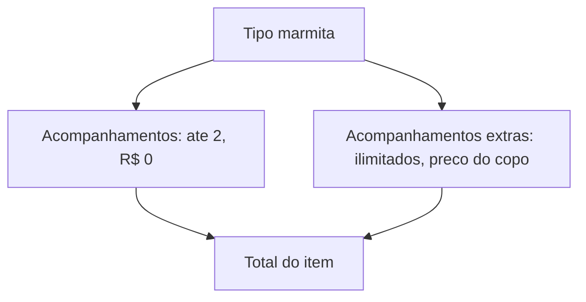

# Acompanhamentos extras na marmita

## Comportamento

Na aba **Marmitas**, além dos 2 acompanhamentos inclusos (sem preço), aparece um campo **Acompanhamentos Extras**. Qualquer item escolhido ali é cobrado com o **mesmo preço do copo** (Sucrilhos R$2, Bis R$3, Nutella R$6, etc.). Sem limite de quantidade nesse campo.

Na aba **Copos** o campo não aparece: acompanhamentos continuam pagos e ilimitados como hoje.

Mesmo item pode estar nos 2 campos (ex.: Granola inclusa + Granola extra), como já acontece com frutas vs frutas extras.



## Cardapio — [src/menu.json](src/menu.json)

Nova categoria espelhando `acompanhamentos`, com ids prefixados (`extra-sucrilhos`, `extra-bis`, …) e os **mesmos `price`**:

```json
{
  "id": "acompanhamentos-extras",
  "name": "Acompanhamentos Extras",
  "toppings": [
    { "id": "extra-sucrilhos", "name": "Sucrilhos", "price": 2 }
  ]
}
```

Copos (incluindo casquinha) ganham `"disabledCategories"` com `"acompanhamentos-extras"` para o campo nao aparecer. Marmitas nao desabilitam essa categoria.

## Preco — [src/lib/menu.ts](src/lib/menu.ts)

Hoje `calcAccompanimentsPrice` zera tudo quando `acompanhamentos` esta incluso — por isso extras precisam de um calculo **separado**, no mesmo estilo de `calcExtraFruitsPrice`:

- `calcExtraAccompanimentsPrice(toppingIds)` soma `price` da categoria `acompanhamentos-extras` (sempre cobra).
- `calcBowlUnitPrice` passa a somar frutas extras + acompanhamentos (inclusos ou nao) + **acompanhamentos extras**.
- `describeBowlToppings` passa a devolver tambem `extraAccompaniments`.

## UI — [src/components/BowlBuilder.tsx](src/components/BowlBuilder.tsx)

O loop de categorias ja esconde o que estiver em `disabledCategories`, entao o campo novo aparece so na marmita, com `+R$` nos chips (categoria nao inclusa).

- Banner amber quando o extra > 0: `Acompanhamentos extras: +R$…`
- Subtitulo da marmita: `Ate 2 frutas e 2 acompanhamentos inclusos. Extras a parte.`

## Pedido e WhatsApp

- [src/components/OrderCart.tsx](src/components/OrderCart.tsx): extras na mesma linha de resumo, com `(+R$)` como frutas extras.
- [src/lib/whatsapp.ts](src/lib/whatsapp.ts): itens extras com `+ Nome (+R$)` e linha `_Acompanhamentos extras: R$…_` quando o valor for > 0. Os 2 inclusos continuam sem preco.

## Verificacao

- `npm run build`
- Browser: copos inalterados (sem campo extra). Marmita: 3o acompanhamento incluso bloqueado; extras selecionaveis, somam no total, aparecem no carrinho e na mensagem do WhatsApp.
