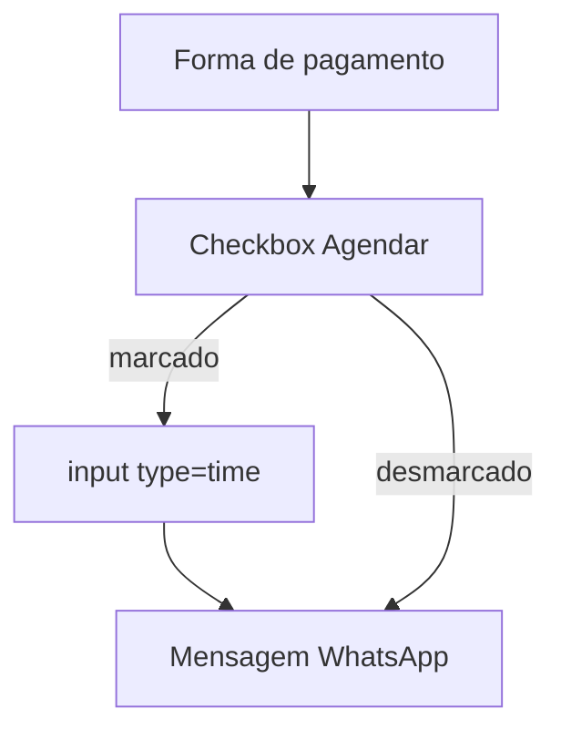

# Agendar pedido por horário

## Contexto

O checkout hoje tem [`PaymentSelector`](src/components/PaymentSelector.tsx) em [`App.tsx`](src/App.tsx), estado em [`useOrder`](src/hooks/useOrder.ts) (`bowls` + `paymentId`) e a mensagem em [`buildWhatsappMessage`](src/lib/whatsapp.ts) (pagamento e total no final). Não há testes; verificação = `npm run build` + fluxo no browser.

## Decisões

- **Só horário do dia** (`HH:MM`), sem data — o pedido é “para hoje neste horário”.
- **Checkbox desmarcado** = pedido para agora; não vai linha de agendamento no WhatsApp.
- **Seletor:** `<input type="time">` (nativo, mesmo padrão visual de `.input` do talher/observações).
- **Validação:** se “Agendar” estiver marcado e o horário vazio, bloquear o envio com “Selecione o horário do agendamento.”
- Desmarcar o checkbox limpa o horário.



## 1. Estado do pedido

Em [`src/types.ts`](src/types.ts), `OrderState` ganha:

```ts
scheduled: boolean
scheduledTime: string  // "" ou "HH:MM"
```

Em [`src/hooks/useOrder.ts`](src/hooks/useOrder.ts):

- Estado inicial: `scheduled: false`, `scheduledTime: ""`.
- `setScheduled(checked)` — se `false`, também zera `scheduledTime`.
- `setScheduledTime(value)`.
- Incluir os dois campos no objeto `order`.

## 2. UI — bloco abaixo do pagamento

Novo componente [`src/components/ScheduleSelector.tsx`](src/components/ScheduleSelector.tsx), no mesmo `card` do pagamento (seção irmã, logo abaixo), estilo do checkbox de talher em [`BowlBuilder.tsx`](src/components/BowlBuilder.tsx):

- Título: **Agendamento**
- Checkbox: **Agendar pedido**
- Com marcado: label **Horário** + `<input type="time" className="input">` (obrigatório na UI)

Em [`src/App.tsx`](src/App.tsx): renderizar o seletor logo após `PaymentSelector`; passar `setScheduled` / `setScheduledTime` do hook; em `validate()`, após o pagamento:

```ts
if (order.scheduled && !order.scheduledTime) {
  return "Selecione o horário do agendamento."
}
```

## 3. WhatsApp

Em [`src/lib/whatsapp.ts`](src/lib/whatsapp.ts), depois da linha de pagamento e antes do total:

```
*Pagamento:* PIX
*Agendado para:* 18:30
*TOTAL: R$ 32,00*
```

Formatar `HH:MM` (já vem assim do `type="time"`). Sem agendamento, essas duas linhas extras não existem — o pedido continua “para agora”.

## Verificação

- `npm run build`
- Browser: confirmar sem agendar (WhatsApp sem linha de horário); marcar sem horário (erro); marcar com horário (mensagem com *Agendado para:* HH:MM); desmarcar some o input e limpa o valor.
