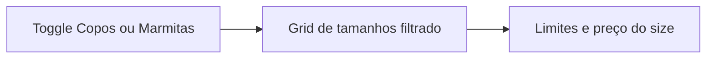

# Toggle Copos / Marmitas

## Contexto

Hoje todos os tamanhos vêm de [`src/menu.json`](src/menu.json) e aparecem juntos no grid de [`src/components/BowlBuilder.tsx`](src/components/BowlBuilder.tsx). Limites de frutas já existem via `categoryMaxSelect` / `maxSelect`; acompanhamentos nos copos são **ilimitados e pagos**. Não há testes automatizados no projeto; a verificação será `npm run build` + fluxo no browser.

## Decisões

- **Dados:** um único array `sizes`, cada item com `kind: "copo" | "marmita"`. O toggle só filtra a lista. Cart, WhatsApp e preço continuam usando `sizeId`.
- **Acompanhamentos da marmita:** inclusos (R$ 0) e no máximo 2. Frutas extras continuam **pagas e sem limite**, como nos copos 300/500ml.
- **Nomes na UI/pedido:** `Marmita Média 400ml` (R$ 20) e `Marmita Grande 600ml` (R$ 30).
- **Troca de aba:** se o tamanho atual não pertence à lista nova, seleciona o primeiro da lista e aplica `filterAllowedToppings` (já corta o que passa do limite).



## 1. Cardápio

Em [`src/menu.json`](src/menu.json):

- Copos atuais ganham `"kind": "copo"`.
- Novos tamanhos:

```json
{ "id": "marmita-400", "name": "Marmita Média 400ml", "price": 20, "kind": "marmita",
  "categoryMaxSelect": { "frutas": 2, "acompanhamentos": 2 },
  "includedCategories": ["acompanhamentos"] }
{ "id": "marmita-600", "name": "Marmita Grande 600ml", "price": 30, "kind": "marmita",
  "categoryMaxSelect": { "frutas": 2, "acompanhamentos": 2 },
  "includedCategories": ["acompanhamentos"] }
```

`SizeId` em [`src/types.ts`](src/types.ts) passa a incluir os dois ids automaticamente (é derivado do JSON).

## 2. Helpers em [`src/lib/menu.ts`](src/lib/menu.ts)

- `getSizeKind(sizeId)` → `"copo" | "marmita"` (default `"copo"`).
- `getSizesByKind(kind)` → filtra `menu.sizes`.
- `isCategoryIncludedInSize(sizeId, categoryId)` → lê `includedCategories`.
- Preço: `calcAccompanimentsPrice` e `calcBowlUnitPrice` passam a receber `sizeId` e **não cobram** categorias inclusas. `calcBowlLineTotal` usa isso.
- `getCategoryMaxSelect` / `filterAllowedToppings` já suportam limite em qualquer categoria; marmita só precisa do JSON.

## 3. UI do montador em [`src/components/BowlBuilder.tsx`](src/components/BowlBuilder.tsx)

- Segmented control **Copos | Marmitas** acima do grid (mesmo estilo dos botões de tamanho: ativo `bg-acai-600`).
- Grid renderiza só `getSizesByKind(kind)`.
- Subtítulo: copo continua “Até 1/2 frutas inclusas no copo”; marmita: “Até 2 frutas e 2 acompanhamentos inclusos”.
- **Generalizar o limite** hoje hardcoded em `frutas`:
  - `toggleTopping` bloqueia qualquer categoria com `maxSelect`.
  - Contador `(n/max)` e chips `atMax` valem para frutas **e** acompanhamentos.
- Chips de acompanhamento **sem** `+R$` quando a categoria está inclusa no size.
- Banner “Complementos: +R$…” some nas marmitas (preço 0).
- Texto de observações: “Observações deste item” (vale copo e marmita).

## 4. Pedido e WhatsApp

- [`src/components/OrderCart.tsx`](src/components/OrderCart.tsx): não mostrar `(+R$)` em acompanhamentos inclusos. Label continua `Açaí {size.name}`.
- [`src/lib/whatsapp.ts`](src/lib/whatsapp.ts): idem — sem linha `_Complementos_` quando o valor é 0.
- [`src/App.tsx`](src/App.tsx): validação “Adicione pelo menos um item ao pedido.”

Talher, leite em pó/condensado e frutas extras permanecem iguais.

## Verificação

- `npm run build` (TypeScript precisa aceitar os novos campos opcionais do JSON).
- No browser: Copos inalterados (200ml 1 fruta; 300/500 2 frutas; casquinha sem frutas; acompanhamentos pagos e ilimitados).
- Aba Marmitas: só 2 opções; 3º acompanhamento bloqueado; 2 acompanhamentos não somam no total; frutas extras ainda somam; item no carrinho e mensagem do WhatsApp com o nome da marmita e sem preço de complemento.
